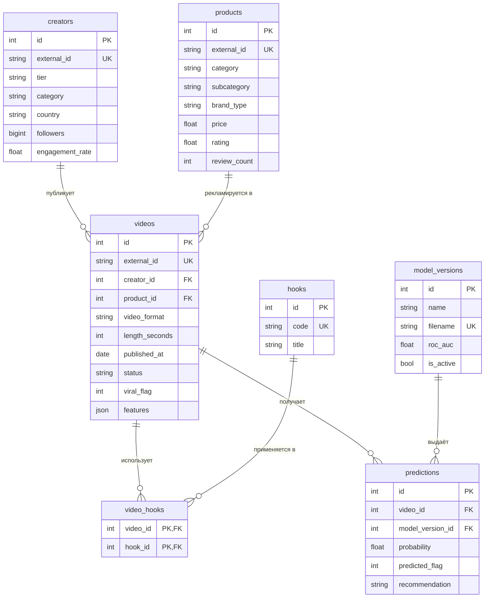

# TikTok Shop Viral Predictor


Информационная система с REST API на FastAPI: хранит видео, креаторов и товары TikTok Shop,
предсказывает **вероятность виральности видео по признакам, известным до или в момент
публикации**, и подсказывает, стоит ли вкладывать рекламный бюджет.

## Предметная область и назначение

Селлер или маркетолог TikTok Shop выбирает, на какие видео тратить бюджет. Система:

- хранит креаторов, товары, видео и «хуки» (приёмы в начале ролика);
- по параметрам видео оценивает вероятность стать виральным и даёт рекомендацию
  `boost` / `watch` / `skip`;
- управляет жизненным циклом видео (`draft → published → boosted / archived`);
- показывает аналитику: какие хуки и креаторы чаще дают виральные видео, динамика по месяцам;
- позволяет загружать собственные обученные модели (`.pkl`) и переключать активную версию.

## Данные и постановка ML

- Датасет: `tiktok_shop_viral_video_sales_attribution_cac.csv`, 100 000 строк, 402 столбца
  (данные за 2025 год).
- Цель: `viral_flag` (доля положительного класса 12,66%).
- В модель попадают только признаки до или в момент публикации (креатор, товар,
  формат ролика, хук, кампания, время). Признаки, появляющиеся после публикации, и всё, что
  напрямую определяет виральность (`viral_traffic_flag`, `video_views`, `view_velocity`, выручка,
  ROAS и др.), исключены как утечка. Полный список: `src/research_graph/ml/features.py`.
- Продажи (`purchase_flag`, `orders`) предсказывать нельзя: в данных всего 2 ненулевые строки
  из 100 000.

### Модели и качество

Очистка (дубликаты, пропуски, типы, выбросы по квантилям 1%/99%), кодирование категорий
(one-hot), масштабирование, разбиение train/test 80/20 со стратификацией, отбор признаков
(`SelectKBest`, 25 признаков). Сравнение трёх алгоритмов по ROC-AUC на тестовой выборке:

| Модель | ROC-AUC |
|---|---|
| Логистическая регрессия | 0,6694 |
| Случайный лес | 0,6694 |
| **Градиентный бустинг (HistGradientBoosting)** | **0,6713** |

Сохраняется лучшая модель: `models/model.pkl` (sklearn Pipeline целиком), метрики и список
выбранных признаков: `models/metrics.json`.

**Ограничение.** Потолок качества около 0,67: почти весь сигнал даёт
`creator_engagement_rate`, остальные признаки близки к шуму. Если
добавить ранние показатели после публикации (просмотры, репосты, скорость просмотров),
ROC-AUC на быстрой проверке достигал около 0,96, но это уже задача «раннего предупреждения»,
а не прогноза до публикации.

## Стек

Python 3.12, FastAPI, Pydantic v2, SQLAlchemy 2.0, Alembic, PostgreSQL 16, pandas,
scikit-learn, joblib, pytest (+pytest-cov), ruff, mypy, uv, Docker Compose, GitHub Actions,
HTML/CSS/JS, ESLint.

## Структура проекта

```
src/research_graph/
├── api/            # роутеры FastAPI, зависимости, единый формат ошибок
├── models/         # SQLAlchemy-модели
├── schemas/        # Pydantic-схемы (create / update / read)
├── services/       # бизнес-логика (видео, креаторы, модели и предсказания, аналитика)
├── etl/            # импорт данных из CSV (transform.py, import_data.py)
├── ml/             # признаки, предобработка, обучение, инференс
├── web/            # клиентский интерфейс (index.html, app.js, styles.css)
├── config.py, db.py, cli.py, main.py
migrations/         # миграции Alembic (обратимые)
models/             # обученная модель и метрики
data/sample/        # выборка 5000 строк для запуска и тестов ETL
docs/               # ERD, промпты, ревью, соответствие требованиям
tests/              # pytest
docker/, Dockerfile, docker-compose.yml
```

## Запуск через Docker (рекомендуется)

```bash
git clone https://github.com/Catorol/PythEngin.git
cd PythEngin
cp .env.example .env      # необязательно: значения по умолчанию подходят
docker compose up --build
```

При старте контейнер сам применяет миграции, импортирует выборку (идемпотентно) и регистрирует
базовую модель. Дальше:

- интерфейс: <http://localhost:8000>
- Swagger: <http://localhost:8000/docs>
- проверка: <http://localhost:8000/health>

Остановить и удалить данные: `docker compose down -v`.

## Локальный запуск (без контейнера приложения)

```bash
uv sync
docker compose up -d db                       # только PostgreSQL
uv run alembic upgrade head                   # схема БД
uv run python -m research_graph.etl.import_data --source data/sample/tiktok_sample.csv
uv run rg register-model                      # зарегистрировать models/model.pkl
uv run uvicorn research_graph.main:app --reload
```

Переобучить модель на полном датасете и создать выборку:

```bash
uv run rg train --csv data/raw/tiktok_shop_viral_video_sales_attribution_cac.csv
uv run rg make-sample --csv data/raw/tiktok_shop_viral_video_sales_attribution_cac.csv
```

Полный CSV лежит в `data/raw/` (в репозиторий не входит).

## Переменные окружения

Хранятся в `.env` (в репозитории только `.env.example`).

| Переменная | По умолчанию | Назначение |
|---|---|---|
| `POSTGRES_USER`, `POSTGRES_PASSWORD`, `POSTGRES_DB` | `rg` | Параметры контейнера PostgreSQL |
| `RG_DATABASE_URL` | `postgresql+psycopg://rg:rg@localhost:5432/rg` | Строка подключения к БД |
| `RG_MODEL_DIR` | `models` | Каталог моделей (загруженные файлы лежат в `uploaded/`) |
| `RG_DATA_DIR` | `data` | Каталог данных |
| `RG_LOG_LEVEL` | `INFO` | Уровень логирования |

## ERD

Диаграмма также лежит в `docs/erd.md`.



### Сущности

- `creators`, `products`: справочники; у видео по одному креатору и товару (связь 1:N).
- `videos`: основная сущность; `status`, `viral_flag`, JSON `features` со снимком признаков
  модели.
- `hooks` и `video_hooks`: типы хуков и связь многие-ко-многим с видео.
- `model_versions`: загруженные модели; активна не более одной.
- `predictions`: история предсказаний (для видео или произвольных записей).

Ограничения целостности: первичные и внешние ключи, `UNIQUE` (`external_id`, `code`, `filename`),
`NOT NULL`, `CHECK` (неотрицательные значения, рейтинг 0–5, статус из набора, вероятность 0–1,
`viral_flag` 0/1), индексы по полям поиска и фильтрации, частичный уникальный индекс «одна
активная модель». Схема меняется только миграциями Alembic (`downgrade` реализован и покрыт
тестом).

## Бизнес-правила

1. **Статусы видео**: допустимы `draft → published | archived`, `published → boosted | archived`,
   `boosted → archived`; из `archived` перехода нет (иначе 409 `invalid_state_transition`).
2. **Усиление бюджета**: в `boosted` видео можно перевести только если его последнее предсказание
   имеет рекомендацию `boost`.
3. **Целостность**: нельзя удалить креатора, у которого есть видео (409); создание видео проверяет
   существование креатора и товара (404) и хуков (400); `external_id` уникален (409).
4. **Рекомендация по вероятности**: `p ≥ 0,20` → `boost`, `p ≥ 0,15` → `watch`, иначе `skip`.
   Пороги подобраны под распределение вероятностей модели: при `p ≥ 0,20` доля виральных видео
   около 23% против 12,7% в среднем.
5. **Транзакционная смена модели**: загрузка новой модели и деактивация предыдущей выполняются
   в одной транзакции; в БД это дополнительно защищено частичным уникальным индексом.
6. **Предсказание без модели**: `/predict` и `/predict-from-csv` возвращают 409
   `model_not_loaded`, если активной модели нет.
7. **Идемпотентность ETL**: повторный запуск импорта не создаёт дубликатов.

## ETL

Скрипт `src/research_graph/etl/import_data.py`:

1. **Извлечение**: чтение нужных столбцов CSV, проверка наличия всех колонок.
2. **Валидация и очистка**: отклоняются строки с пустыми id, дубликатами `video_id`,
   некорректной датой, `viral_flag` вне {0, 1}, некорректными числами (отрицательные
   подписчики/цена, рейтинг вне 0–5, длительность ≤ 0). Причины отказов считаются отдельно.
3. **Преобразование**: строки раскладываются по таблицам `creators`, `products`, `videos`,
   `hooks`, `video_hooks` (флаги хуков → связи многие-ко-многим); признаки модели сохраняются
   в `videos.features`.
4. **Загрузка**: пакетная вставка одной транзакцией, пропуск уже существующих `external_id`.

Запуск:

```bash
uv run python -m research_graph.etl.import_data --source data/sample/tiktok_sample.csv [--limit N]
```

Пример журнала первого запуска:

```
ETL завершён: прочитано=5000, отклонено=0 (нет), добавлено: креаторов=866, товаров=5000,
видео=5000, связей с хуками=3527; видео уже было в БД=0
```

Повторный запуск: добавлено 0, `видео уже было в БД=5000`. В датасете один `creator_id` встречается
с разными tier и числом подписчиков (данные синтетические), поэтому профиль креатора берётся
из первой встреченной строки, а фактические значения каждого видео хранятся в `videos.features`.

## API

Полное описание с примерами: Swagger на `/docs`. Ошибки всегда в формате
`{"error": {"code": "...", "message": "...", "details": ...}}`.

| Метод и путь | Назначение |
|---|---|
| `GET /health` | Проверка работоспособности |
| `GET, POST /creators`, `GET, PATCH, DELETE /creators/{id}` | Креаторы (пагинация, фильтры, сортировка) |
| `GET, POST /products`, `GET /products/{id}`, `GET /hooks` | Товары и справочник хуков |
| `GET, POST /videos`, `GET, PATCH, DELETE /videos/{id}` | Видео (фильтры по статусу, креатору, формату, дате; сортировка) |
| `PATCH /videos/{id}/status` | Смена статуса (бизнес-правила 1–2) |
| `POST /videos/{id}/predict` | Предсказание по сохранённому видео |
| `POST /upload-model` | Загрузка модели `.pkl`, делает её активной |
| `GET /models`, `POST /models/{id}/activate` | Версии моделей |
| `POST /predict` | Предсказание для одной или нескольких записей |
| `POST /predict-from-csv` | Предсказание по CSV, `roc_auc` при наличии `viral_flag` |
| `GET /analytics/virality-by-hook` | Доля виральных по типам хуков |
| `GET /analytics/top-creators` | Топ-N креаторов |
| `GET /analytics/viral-trend` | Динамика по месяцам |

`/predict-from-csv` принимает CSV, содержащий все признаки модели (например, часть исходного
датасета после `train_test_split`), и возвращает `roc_auc` (если есть `viral_flag` с двумя
классами) и набор с колонками `predicted_probability`, `predicted_viral_flag`,
`recommendation`. Параметр `limit` задаёт, сколько строк вернуть в JSON; `format=csv` отдаёт
весь набор файлом (ROC-AUC в заголовке `X-ROC-AUC`).

## Интерфейс

Одностраничное приложение на HTML/CSS/JS (`/`): прогноз по форме и по CSV, список видео
(фильтры, сортировка, пагинация, создание, редактирование, удаление, смена статуса,
предсказание), креаторы, версии моделей, аналитика. Ошибки API показываются пользователю в
сообщении вверху страницы.

## Тесты и качество

```bash
uv run pytest                  # тесты + покрытие, порог 70%
uv run ruff check .
uv run ruff format --check .
uv run mypy
npm ci
npm run lint         # ESLint для фронтенда
```

- Unit-тесты: бизнес-правила, рекомендации, очистка данных и ETL-функции, инференс.
- Интеграционные тесты API на `TestClient` с отдельной SQLite-базой на каждый тест,
  включая негативные сценарии (404, 409, 422, 400).
- Тест обратимости миграций (`upgrade` / `downgrade`).
- Проверка на PostgreSQL выполняется в CI smoke-тестом полного стека Docker.

## CI

GitHub Actions (`.github/workflows/ci.yml`), запуск при каждом push в `main` и каждом PR:

- `backend`: ruff, mypy, pytest с порогом покрытия 70%, отчёт покрытия как артефакт;
- `frontend`: ESLint;
- `docker`: `docker compose up --build` и проверка эндпоинтов.

## Ограничения

- Загрузка `.pkl` исполняет код при чтении файла: эндпоинт рассчитан на доверенных пользователей.
- Качество варианта A ограничено данными (ROC-AUC около 0,67).
- Для `/predict-from-csv` нужны все признаки модели; one-hot-кодированный CSV не поддерживается.
- Пороги рекомендаций подобраны под базовую модель; для другой модели их нужно пересчитать
  (`src/research_graph/services/recommendation.py`).
