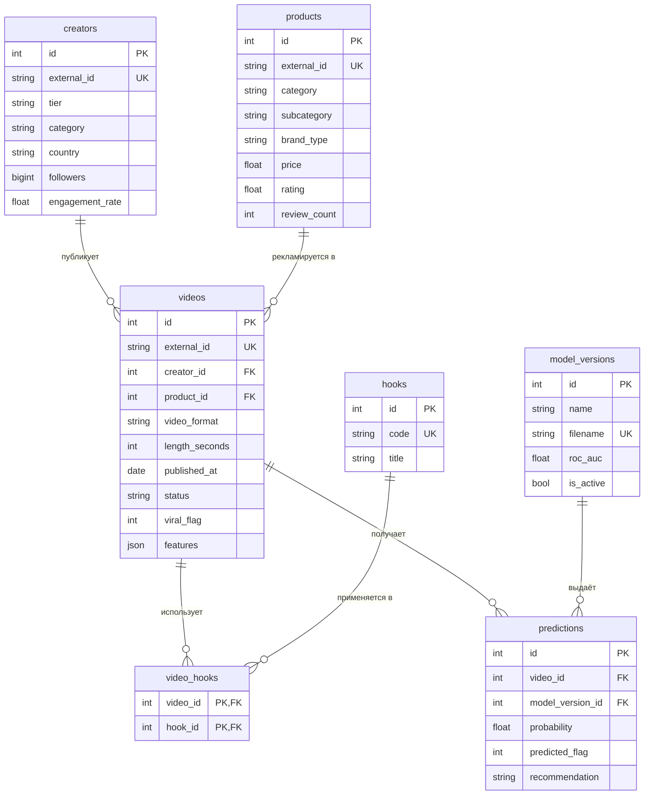

# ERD

## Сущности

- `creators`, `products`: справочники, у видео по одному из каждого (1:N).
- `videos`: ключевая сущность; `features` хранит снимок признаков модели для инференса.
- `hooks` и `video_hooks`: типы «хуков» и связь многие-ко-многим с видео.
- `model_versions`: загруженные модели, активна только одна (частичный уникальный индекс).
- `predictions`: история предсказаний.
